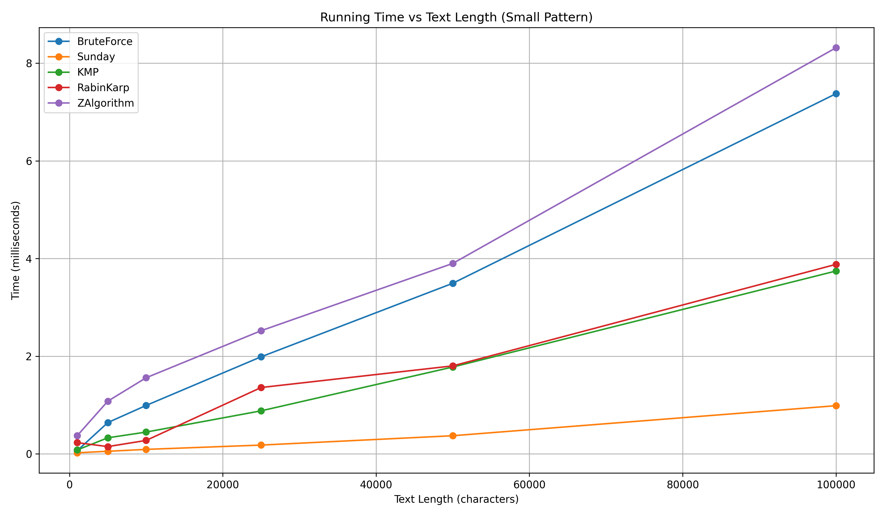
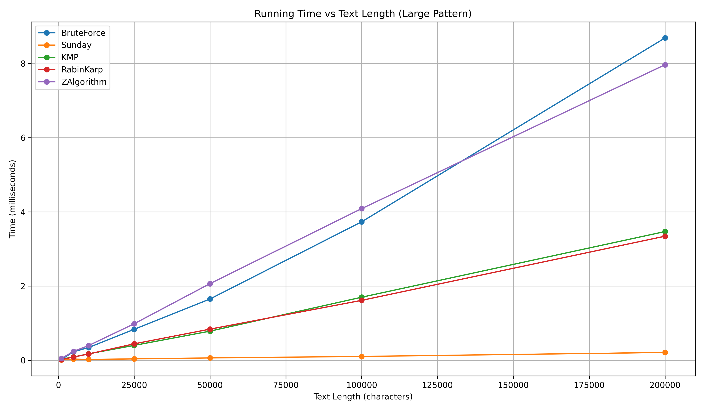
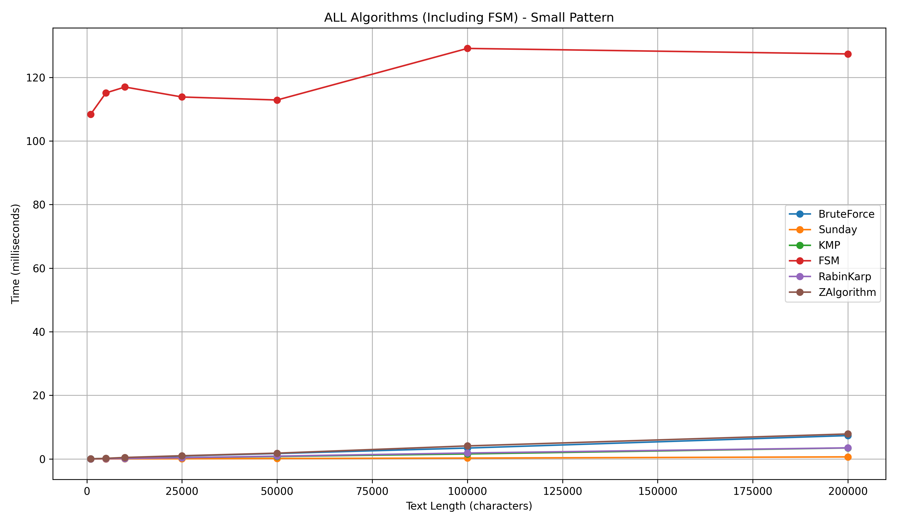
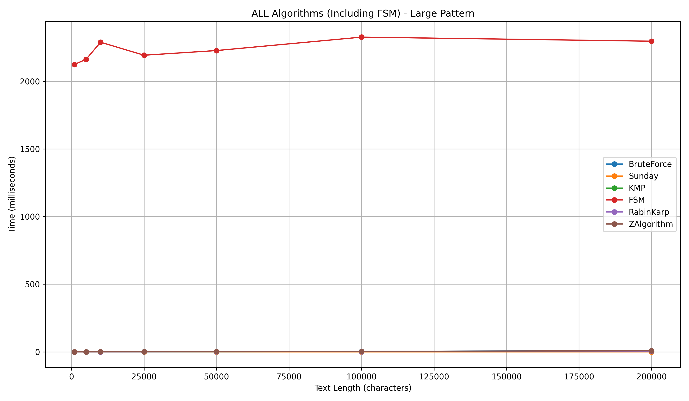

# String-Matching Algorithms

C++17 implementations and benchmarks of classic string-matching algorithms, plus two extensions: wildcard matching and a 2D rolling hash. Written for the **Algorithms II** course (Assignment 1) at the University of Łódź.

## Contents

| Folder | Task | Techniques |
|---|---|---|
| `Part1/1A` | Compare six matchers on a real book with a short and a long pattern | Brute force, Sunday, KMP, finite-state machine (FSM), Rabin–Karp, Gusfield Z |
| `Part1/1B` | Find specific inputs where one algorithm is at least 2× faster than another | Three adversarial text/pattern pairs, each text at least 100 kB |
| `Part2` | Pattern matching with `?` (any one character) and `*` (any sequence) wildcards, escapable with `\` | Pattern tokenization; wildcard-aware brute force and Sunday |
| `Part3` | Detect whether the top-right K×K corner of an M×N picture appears elsewhere in it | 2D rolling hash using bitwise masks instead of modulo |

## Results

### Part 1A: running time against text length

Text is `book.txt` (about 170 kB). A small pattern (70 characters) and a large pattern (300 characters) are taken from the end of the book, and the text is the first N characters. Each time is the average of 30 runs. Because the pattern is not in the prefix, every run is a full scan with no match (`FoundIndex = -1` in `results.csv`).

Time in milliseconds at text length 100,000:

| Pattern | Brute force | Sunday | KMP | Rabin–Karp | Z | FSM |
|---|---:|---:|---:|---:|---:|---:|
| Small (70 chars) | 6.71 | 0.90 | 3.29 | 5.16 | 15.73 | 261.5 |
| Large (300 chars) | 10.79 | 1.02 | 5.70 | 3.43 | 11.87 | 6,523 |

- Sunday is the fastest on this input. When the character after the window is not in the pattern, it can skip ahead by up to m + 1 positions, so it does far fewer comparisons than the others.
- The FSM takes about the same time at 1,000 characters as at 100,000 (about 245 ms for the small pattern), so its cost is dominated by building the transition table, not by scanning. It grows with pattern length (about 6.5 s for 300 characters). It is shown on separate graphs for that reason.
- Brute force, KMP, Rabin–Karp and Z all grow linearly with text length here.






### Part 1B: inputs where the "slower" algorithm wins

Each pair is an explicit text T and pattern P, and the result is saved in a `.txt` file in the same folder.

| Claim | T | P | Result |
|---|---|---|---:|
| Sunday ≥ 2× faster than Z | 1,000,000 × `E` | `ABCDABCDABCD` | **19.2×** (4,869 µs vs 93,475 µs) |
| KMP ≥ 2× faster than Rabin–Karp | 500,000 chars alternating `a`/`b` | `ababa` | **3.3×** (19,984 µs vs 66,882 µs) |
| Rabin–Karp ≥ 2× faster than Sunday | 500,000 × `a` | 255 × `a` followed by `b` | **7.9×** (18,788 µs vs 149,227 µs) |

Why each one works:

- **Sunday vs Z:** no character of T occurs in P, so Sunday jumps ahead by the full pattern length plus one each step and touches only a small fraction of T, while Z must process every character.
- **KMP vs Rabin–Karp:** the Rabin–Karp used here has a deliberately tiny modulus (q = 2), so the hash matches at many positions and it repeats character-by-character verification there. KMP never moves backwards in the text.
- **Rabin–Karp vs Sunday:** P looks like the text for 255 characters and differs only at the end. Sunday compares about 255 characters at each position and shifts by only a couple of positions, which is close to O(n·m). Rabin–Karp's window hash almost never equals the pattern's hash, so it rarely needs verification and runs in about O(n).

### Part 2: wildcard matching

`bruteForceMatch` and `sundayMatch` (both in `Part2/`) return `true` if the pattern, with `?` and `*` wildcards, matches anywhere in the text. A backslash escapes `?`, `*` and `\`. The pattern is first tokenized into literals, single-character wildcards and star wildcards. For Sunday, the pattern is split at each `*` into segments, and each segment is searched in turn using a Sunday shift table. `?` limits how far the window may shift, because it can match any character. `main.cpp` runs both on the same input and reports whether they agree.

### Part 3: top-right corner duplicated in a picture

`topRightCornerAppearsAgain(picture, k)` takes a picture of any element type (templated) and returns whether its top-right K×K block appears elsewhere. It computes a rolling hash along each row, then a rolling hash down the columns of those row hashes, so each K×K block's hash is updated in constant time. All hash arithmetic uses a bitwise mask (`& 0xFFFFFFFF`) instead of modulo by a prime. Hash hits are verified element by element, so a collision cannot produce a wrong answer. The hashing work is O(M·N) and the O(K²) verification runs only on hash hits.

## Building and running

Requires a C++17 compiler (for example `g++`). Compile and run from inside each folder, because input files are read by relative path.

```bash
cd Part1/1A
g++ -O2 -std=c++17 main.cpp -o run
./run               # Windows Command Prompt: run
```

- `Part1/1A` reads `book.txt` and writes `results.csv`. Create the graphs with `python graph.py` (needs `pandas` and `matplotlib`).
- Each folder in `Part1/1B` is a separate program that writes its result to a `.txt` file.
- `Part2`: `g++ -std=c++17 main.cpp Sunday.cpp bruteForce.cpp -o run`, then enter a text and a pattern when asked.
- `Part3`: `g++ -std=c++17 main.cpp -o run`. It runs four built-in test pictures.

## Notes

- Timings are from a single machine and will vary between runs and systems. The ratios between algorithms are more meaningful than the absolute numbers.
- This is university coursework written to the assignment specification.
